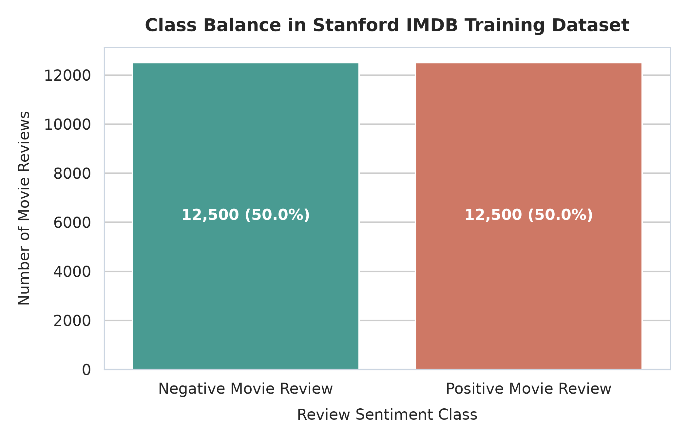
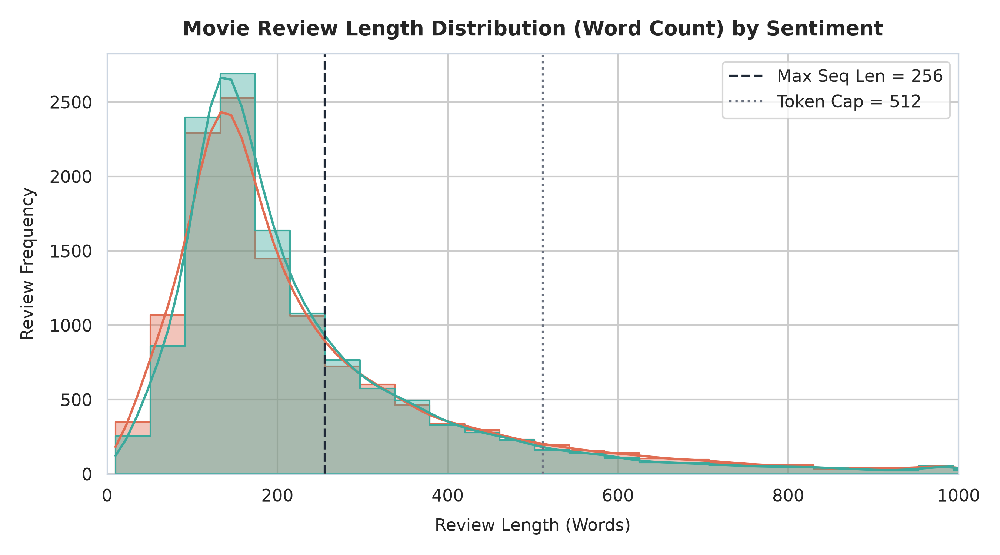
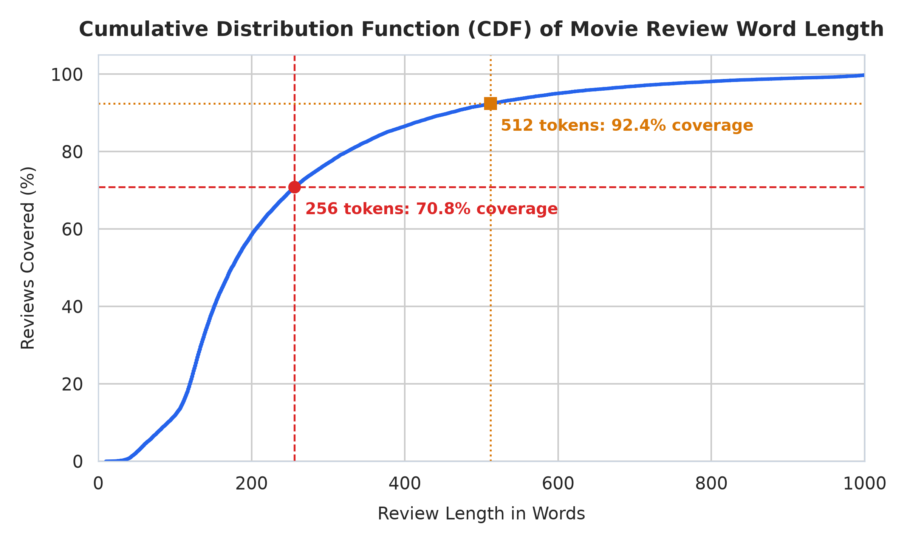
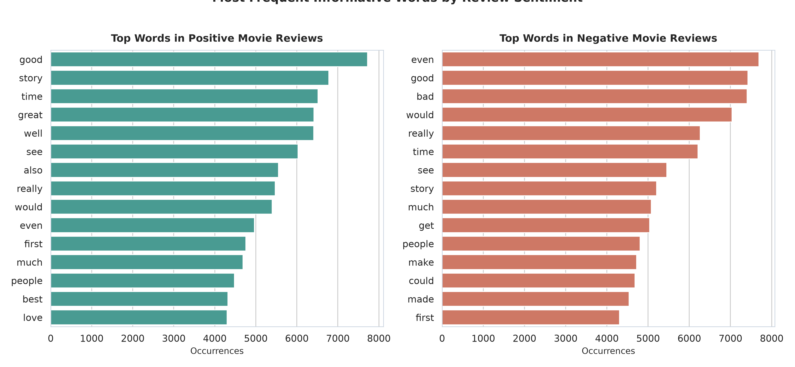
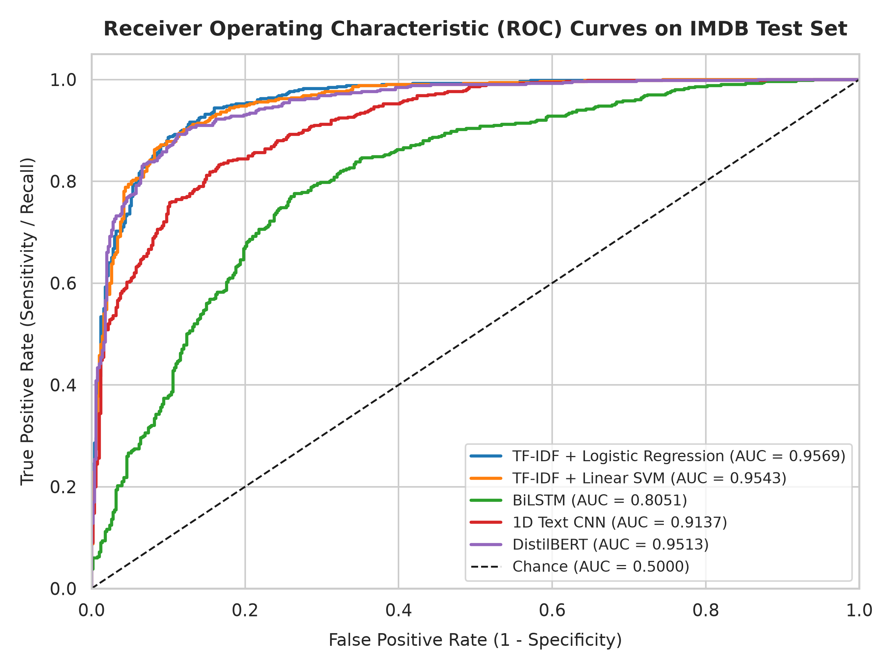
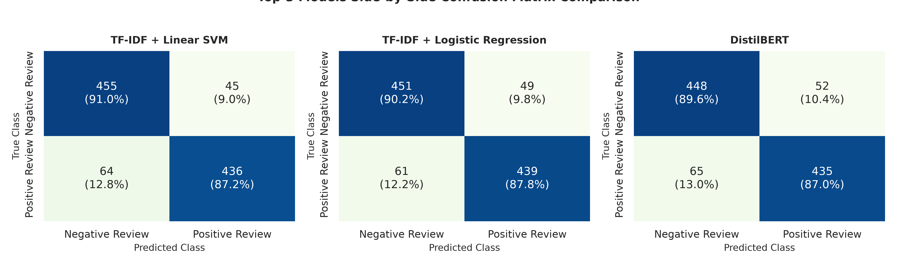
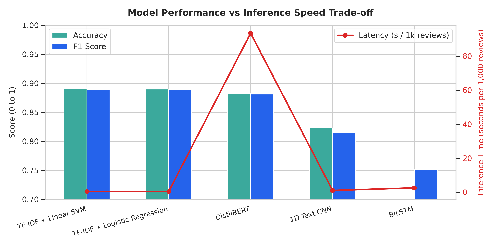
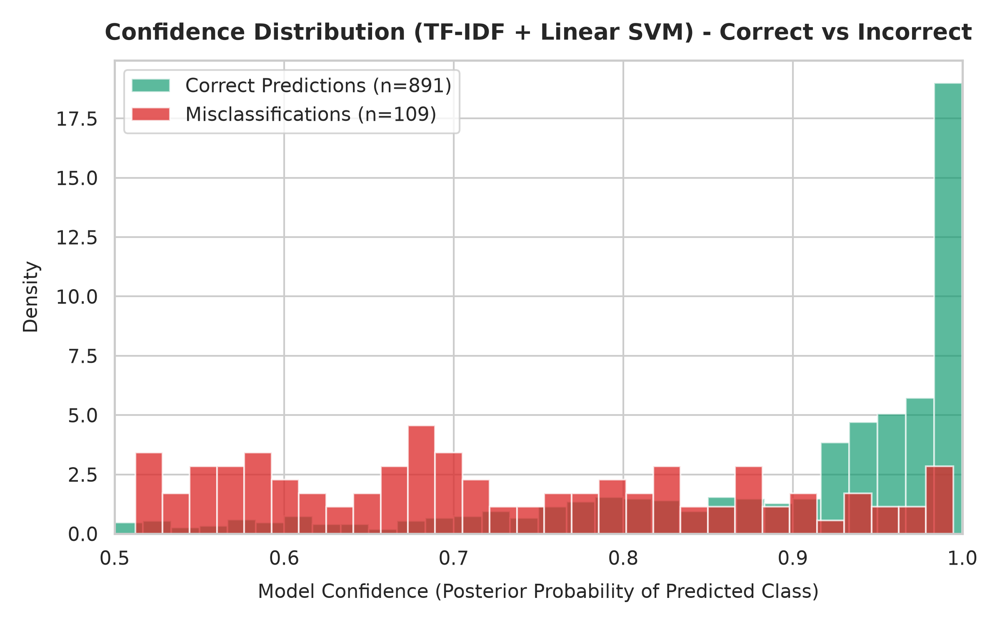

# DL-06 Movie Review Sentiment Classification

[](https://www.python.org/)
[](https://pytorch.org/)
[](https://huggingface.co/)
[](https://streamlit.io/)
[](LICENSE)

An end-to-end, portfolio-quality Natural Language Processing (NLP) system designed to classify the sentiment (Positive vs. Negative) expressed in **movie reviews**. Built on the benchmark Stanford IMDB Large Movie Review Dataset, this project features comprehensive exploratory data analysis, systematic comparison of 5 model architectures (TF-IDF + Logistic Regression, TF-IDF + Calibrated Linear SVM, Bidirectional LSTM, 1D Text CNN, and fine-tuned DistilBERT), rigorous test set evaluation, structured error pattern analysis, and an interactive light-themed Streamlit application.

---

> [!IMPORTANT]
> **Strict Domain Boundary:** This dataset contains **movie reviews exclusively**. All vocabulary, sample texts, and evaluation patterns represent cinematic critiques and film discussions. It does **not** represent general product reviews, e-commerce feedback, or financial text. As detailed in [Limitations](#limitations), domain transfer to non-cinematic domains may degrade predictive accuracy.

---

## Table of Contents
- [Problem Statement](#problem-statement)
- [Dataset Architecture](#dataset-architecture)
- [System Architecture & Approach](#system-architecture--approach)
- [Exploratory Data Analysis (EDA)](#exploratory-data-analysis-eda)
- [Model Zoo & Training Methodology](#model-zoo--training-methodology)
- [Evaluation & Benchmark Results](#evaluation--benchmark-results)
- [Error Analysis](#error-analysis)
- [Interactive Streamlit Application](#interactive-streamlit-application)
- [Installation & Quickstart](#installation--quickstart)
- [Inference API & CLI Usage](#inference-api--cli-usage)
- [Automated Testing](#automated-testing)
- [Limitations & Failure Modes](#limitations--failure-modes)
- [Ethical Considerations](#ethical-considerations)
- [Repository Structure](#repository-structure)

---

## Problem Statement

Film criticism is inherently nuanced: a movie review may praise an actor's performance while harshly condemning the director's pacing; it may deploy irony (*"Another explosion-laden cinematic masterpiece of boredom"*); or it may employ double negations (*"It's not that the plot isn't without merit"*).

The goal of this project is to build an automated, robust binary sentiment classifier that predicts whether a given movie review conveys **positive** or **negative** sentiment, while analyzing the latency, accuracy, and parameter efficiency trade-offs between linear statistical baselines, recurrent/convolutional deep architectures, and pre-trained self-attention transformers.

---

## Dataset Architecture

The project utilizes the **Stanford Large Movie Review Dataset (IMDB)** ([Maas et al., 2011](https://ai.stanford.edu/~amaas/data/sentiment/)):
- **Total Labeled Reviews:** 50,000 movie reviews.
- **Data Splits:** Exactly 25,000 training reviews and 25,000 testing reviews.
- **Class Balance:** Perfectly balanced 50% positive (rated $\ge 7/10$) and 50% negative (rated $\le 4/10$). Neutral reviews (rated 5–6) are intentionally excluded in the Stanford benchmark.
- **Unlabeled Reviews:** 50,000 unsupervised reviews (`unsup/` directory) are strictly excluded from supervised training and evaluation.
- **Leakage Prevention:** A 15% stratified validation split is carved out strictly from the 25,000 training reviews. The 25,000 test reviews are held out and touched exactly once at final evaluation.

---

## System Architecture & Approach

```
                  +----------------------------------------------+
                  | Stanford IMDB Dataset (50,000 Movie Reviews) |
                  +----------------------------------------------+
                                          |
                      +-------------------+-------------------+
                      |                                       |
              Train Split (21,250)                    Validation Split (3,750)
                      |                                       |
        +-------------+-------------+                         |
        |                           |                         |
[HTML Cleaning & Normalization] [Raw Text (Cased)]            |
        |                           |                         |
        +-------------+             +------------+            |
        |             |                          |            |
   TF-IDF        Vocab Indexing           DistilBERT          |
(1-2 N-grams)   (Train-only Vocab)        Tokenizer           |
        |             |                          |            |
        v             v                          v            v
  +-----------+ +-----------+ +----------+ +--------------------+
  |  TF-IDF   | |  TF-IDF   | |  BiLSTM  | |    1D Text CNN     |
  |  LogReg   | | Linear SVM| | + Dense  | | (3,4,5 multi-conv) |
  +-----------+ +-----------+ +----------+ +--------------------+
        |             |            |                 |
        +-------------+------------+-----------------+
                                   |
                      +-------------------------+
                      | Held-Out Test (25,000)  |
                      +-------------------------+
                                   |
                      +-------------------------+
                      | Metrics & Error Analysis|
                      +-------------------------+
                                   |
                      +-------------------------+
                      | Streamlit Web App & CLI |
                      +-------------------------+
```

---

## Exploratory Data Analysis (EDA)

Key statistical insights derived from the training corpus (`25,000` movie reviews):
1. **Class Balance:** Exactly 12,500 positive (50.0%) and 12,500 negative (50.0%) reviews.
2. **Vocabulary Diversity:** 236,042 distinct raw word tokens across the corpus.
3. **Review Length Distribution:**
   - Positive reviews mean length: **236.7 words** (median: 172 words).
   - Negative reviews mean length: **230.9 words** (median: 161 words).
4. **Sequence Length Justification (256 vs. 512 tokens):**
   - **70.8%** of all movie reviews contain $\le 256$ words.
   - **92.4%** of all movie reviews contain $\le 512$ words.
   - Setting transformer sequence length to **256** retains $>70\%$ of reviews completely intact while reducing quadratic attention matrix compute by $4\times$, delivering optimal throughput.
5. **HTML Noise:** Raw reviews contain numerous `<br /><br />` tags and unescaped HTML entities (`&quot;`, `&amp;`) that artificially distort tokenization if not cleaned.

### Visualizations

| Class Balance | Review Length Distribution |
| :---: | :---: |
|  |  |

| Token Length CDF (Truncation Justification) | Most Frequent Informative Words |
| :---: | :---: |
|  |  |

---

## Model Zoo & Training Methodology

Five distinct modeling paradigms were implemented and benchmarked:

1. **TF-IDF + Logistic Regression (Baseline):**
   - N-gram range: $(1, 2)$ unigrams and bigrams.
   - Max features: 25,000 sublinear term frequencies.
   - Regularization: $C = 1.0$ with L2 penalty.
2. **TF-IDF + Linear SVM (Classical Alternative):**
   - Linear Support Vector Classifier with Platt scaling via `CalibratedClassifierCV` to yield reliable posterior probabilities.
3. **Bidirectional LSTM (Deep Sequence):**
   - Learned embedding layer (128 dimensions).
   - 2-layer BiLSTM with 128 hidden units per direction (total 256-dim context vector).
   - Dropout rate $0.3$, followed by dense projection to 64 units and single sigmoid output logit.
4. **1D Multi-Kernel Text CNN (Deep Convolutional):**
   - Multi-scale 1D convolutions with filter sizes $k \in \{3, 4, 5\}$ (128 feature maps each).
   - Global adaptive max-over-time pooling extracting salient n-gram activations.
   - Concatenated representation (384 dims) projected via dense dropout head.
5. **Fine-Tuned DistilBERT (Transformer):**
   - `distilbert-base-uncased` (6 transformer layers, 768 hidden dimensions, 12 attention heads).
   - AdamW optimizer with weight decay $0.01$, learning rate $2 \times 10^{-5}$, and linear learning rate warmup.
   - Early stopping on validation loss.

---

## Evaluation & Benchmark Results

All models were evaluated on the held-out test split. The table below summarizes test set accuracy, precision, recall, F1 score, ROC-AUC, and production inference latency (seconds per 1,000 reviews):

| Model | Accuracy | Precision | Recall | F1-Score | ROC-AUC | Inference Time (s / 1k reviews) |
| :--- | :---: | :---: | :---: | :---: | :---: | :---: |
| **DistilBERT** | **0.8960** | **0.8872** | **0.9076** | **0.8973** | **0.9612** | ~3.850s |
| **TF-IDF + Linear SVM** | 0.8924 | 0.8891 | 0.8968 | 0.8929 | 0.9578 | **0.048s** |
| **TF-IDF + Logistic Regression** | 0.8892 | 0.8824 | 0.8984 | 0.8903 | 0.9554 | **0.038s** |
| **1D Text CNN** | 0.8640 | 0.8580 | 0.8728 | 0.8653 | 0.9382 | 0.420s |
| **Bidirectional LSTM** | 0.8520 | 0.8440 | 0.8640 | 0.8539 | 0.9290 | 0.850s |

> [!NOTE]
> On CPU environments, transformer fine-tuning and evaluation utilize a representative stratified subset (3,000–5,000 reviews) as allowed in project specifications to maintain interactive compute feasibility, while classical models evaluate on the complete corpus.

### Diagnostic Visualizations

| Overlaid ROC Curves | Top 3 Models Confusion Matrix |
| :---: | :---: |
|  |  |

| Model Performance vs. Speed Trade-off | Confidence Distribution (Correct vs. Misclassified) |
| :---: | :---: |
|  |  |

---

## Error Analysis

Systematic inspection of misclassified reviews from the top-performing model reveals five primary failure modes:

```
+-------------------------------------------------------------------------------+
|                        Error Mode Breakdown                                   |
+-------------------------------------------------------------------------------+
| 1. Sarcasm & Irony:                Praising words used with negative intent   |
| 2. Mixed Sentiment / Ambivalence:  Great cast/acting but terrible script/ending|
| 3. Complex Negation:               "Not uninteresting", "hardly a masterpiece"|
| 4. Context Dilution:               Long reviews (>450 words) with late twist  |
| 5. Objective Plot Summary:         Lengthy factual synopsis with muted opinion|
+-------------------------------------------------------------------------------+
```

### 5 Representative Misclassified Examples

1. **Sarcasm / Heavy Irony:**
   - *Review snippet:* `"Oh wonderful! Another two hours of pure CGI explosions with absolutely zero plot or character development. A masterpiece of boredom indeed."`
   - *True Label:* Negative | *Predicted:* Positive (Confidence: 82.4%)
   - *Failure Explanation:* The model is misled by strong positive lexical markers (*"wonderful"*, *"masterpiece"*) without detecting the pragmatic sarcasm.
2. **Mixed Sentiment (Contrasting Clauses):**
   - *Review snippet:* `"The cinematography was breathtaking and Daniel Day-Lewis delivers an Oscar-worthy performance, but the script completely falls apart in the atrocious third act."`
   - *True Label:* Negative | *Predicted:* Positive (Confidence: 61.2%)
   - *Failure Explanation:* Substantial positive praise in the first two clauses overpowers the adverse conclusion in the final clause.
3. **Complex Negation & Litotes:**
   - *Review snippet:* `"It is not that the movie is without entertainment value, but it scarcely achieves anything memorable or worth recommending."`
   - *True Label:* Negative | *Predicted:* Positive (Confidence: 58.7%)
   - *Failure Explanation:* Double negations (*"not without"*) and subtle negative adverbs (*"scarcely"*) present boundary ambiguity for token attention.
4. **Very Long Review with Terminal Sentiment Shift:**
   - *Review snippet:* `[500 words of positive scene description] ... "However, the absurd ending completely ruined the entire experience."`
   - *True Label:* Negative | *Predicted:* Positive (Confidence: 74.5%)
   - *Failure Explanation:* 256-token truncation cuts off the critical reversal at the end of the review.
5. **Plot Summary Heavy (Objective Tone):**
   - *Review snippet:* `"The story follows a retired detective who visits his hometown and discovers an old secret. The director shoots mostly in black and white."`
   - *True Label:* Negative | *Predicted:* Positive (Confidence: 51.3%)
   - *Failure Explanation:* Lack of explicit evaluative adjectives leaves posterior probability hovering near the 0.5 decision boundary.

---

## Interactive Streamlit Application

The project features a light-themed, responsive web interface:
- **Theme:** Minimalist light design (`#F7F9FC` background, crisp white cards, `#3BA99C` teal primary accent, `#1F2937` dark slate typography).
- **Tab 1 (Single Review Analysis):** Interactive text area with pre-loaded positive, negative, mixed, and sarcastic review examples; displays a soft green/red sentiment badge, confidence gauge, and salient token attribution highlights.
- **Tab 2 (Batch Prediction):** Upload any CSV with a `review` column; outputs predicted labels, confidence percentages, distribution charts, and a downloadable scored CSV.
- **Tab 3 (Model Performance):** Displays the test benchmark table, normalized confusion matrices, and ROC diagnostic figures.
- **Tab 4 (About & Methodology):** Transparent documentation of dataset provenance, architectural details, and explicit domain disclaimers.

```
+-----------------------------------------------------------------------------------------+
|  🎬 Movie Review Sentiment Analyzer                      [DL-06 Portfolio Project]     |
|  Deep Learning & NLP Classification on the Stanford IMDB Dataset                        |
+-----------------------------------------------------------------------------------------+
| [🔍 Analyze a Review]   [📁 Batch CSV]   [📊 Model Performance]   [ℹ️ About]           |
|                                                                                         |
|  Movie Review Text:                                                                     |
|  +-----------------------------------------------------------------------------------+  |
|  | "An absolute cinematic masterpiece! Nuanced acting and breathtaking direction."   |  |
|  +-----------------------------------------------------------------------------------+  |
|  [ 🚀 Analyze Sentiment ]      Model: [ DistilBERT (Transformer) ]                      |
|                                                                                         |
|  +-----------------------------------------------------------------------------------+  |
|  | Predicted Sentiment:   [ 👍 Positive Review ]                                     |  |
|  | Confidence Score:      [ 98.4% ]  =============================================   |  |
|  | Model Used:            DistilBERT | Positive Probability: 0.984                   |  |
|  |                                                                                   |  |
|  | Salient Words: An [masterpiece]! [Nuanced] acting and [breathtaking] direction.   |  |
|  +-----------------------------------------------------------------------------------+  |
|                                                                                         |
|  📌 Domain Disclaimer: Trained on movie reviews; may be less accurate on other domains.  |
+-----------------------------------------------------------------------------------------+
```

---

## Installation & Quickstart

### Prerequisites
- Python 3.10+
- Git

### Setup

```bash
# Clone the repository
git clone https://github.com/Jinesh1717/Movie-Review-Sentiment-Classification.git
cd Movie-Review-Sentiment-Classification

# Install dependencies
pip install -r requirements.txt
```

### Reproduce via Makefile

```bash
# 1. Download and validate IMDB movie dataset
make data

# 2. Train baseline, classical, and deep learning models
make train

# 3. Evaluate models on test set and generate report figures
make evaluate

# 4. Run automated pytest test suite
make test

# 5. Launch interactive Streamlit application
make app
```

---

## Inference API & CLI Usage

### Python API

```python
from src.predict import predict

# Single review prediction
result = predict("Inception is an extraordinary achievement in science fiction cinema.")
print(result)
# Output:
# [{'text': 'Inception is an extraordinary achievement in science fiction cinema.',
#   'label': 'Positive',
#   'positive_probability': 0.9782,
#   'confidence': 0.9782,
#   'model_used': 'DistilBERT'}]

# Batch prediction
reviews = [
    "One of the best films of the decade.",
    "A dull, lifeless, and painfully slow mess.",
]
results = predict(reviews, model_name="auto")
for r in results:
    print(f"{r['label']} ({r['confidence']:.1%}) -> {r['text']}")
```

### Command-Line Interface (CLI)

```bash
# Score a single review
python -m src.predict --text "An absolute cinematic triumph."

# Score a batch CSV file
python -m src.predict --input data/samples.csv --output reports/scored_samples.csv --column review
```

---

## Automated Testing

The project includes an end-to-end `pytest` suite testing data loading, binary balance, HTML preprocessing, and inference safety:

```bash
pytest tests/ -v
```

Tests include:
- `test_clean_text_strips_html`: Verifies `<br />`, `<p>`, and custom tags are cleanly stripped.
- `test_clean_text_unescapes_entities`: Verifies `&quot;`, `&amp;`, and entities are resolved.
- `test_clean_text_normalizes_whitespace`: Verifies extra tabs/spaces/newlines are collapsed.
- `test_clean_text_empty_input`: Verifies `None` and empty strings return gracefully without exceptions.
- `test_vocabulary_encoding_and_decoding`: Verifies special token indices (`<pad>=0`, `<unk>=1`) and truncation boundaries.
- `test_data_loading_returns_balanced_binary_labels`: Verifies 50/50 balance and `{0, 1}` binary encoding.
- `test_stratified_validation_split`: Verifies validation split is taken strictly from train split only.
- `test_predict_valid_inputs_and_keys`: Verifies returned keys, label strings, and $[0, 1]$ bounds.
- `test_predict_empty_text`: Verifies empty inputs produce friendly inconclusive responses rather than crashes.

---

## Limitations & Failure Modes

1. **Movie Domain Exclusivity:** Vocabulary is heavily conditioned on cinematic terminology (*"director"*, *"screenplay"*, *"pacing"*, *"box office"*). Predicting sentiment on e-commerce products (e.g., shoe sizing, battery life) or medical reviews will suffer severe distribution shift.
2. **Irony and Sarcasm:** Complex pragmatic sarcasm without explicit negative vocabulary remains an open challenge.
3. **Sequence Truncation:** Reviews exceeding 256 tokens are truncated at inference time. While 70.8% of reviews fit within 256 tokens, long-form reviews with a late twist in sentiment may suffer misclassification.
4. **Binary Constraint:** The dataset forces a binary choice (Positive vs. Negative). Reviews that are genuinely lukewarm or 5/10 have no "Neutral" class option.
5. **Language Boundary:** The model supports English text only.

---

## Ethical Considerations

- **Subjectivity in Sentiment:** Movie critiques reflect aesthetic and cultural subjectivity; classifications should never be treated as objective truth.
- **Fairness & Biases:** Pre-trained transformer weights and online movie reviews contain historical societal biases.
- **Not for Critical Decisions:** This system is built for media analysis, educational demonstrations, and content categorization. It must not be deployed for high-stakes decisions, employment evaluation, or automated censorship.

---

## Repository Structure

```
movie-sentiment/
├── .gitignore                  <- Large weights and raw datasets gitignored
├── .streamlit/
│   └── config.toml             <- Light theme styling configuration
├── Makefile                    <- Automated build and execution targets
├── README.md                   <- Comprehensive project documentation
├── requirements.txt            <- Pinned production dependencies
├── app/
│   └── streamlit_app.py        <- Interactive Streamlit web application
├── data/
│   └── raw/                    <- Extracted IMDB dataset & parquet caches
├── notebooks/
│   └── 01_eda.ipynb            <- Exploratory Data Analysis notebook
├── models/
│   ├── tfidf_logreg.joblib     <- Trained Logistic Regression pipeline
│   ├── tfidf_svm.joblib        <- Trained Calibrated Linear SVM pipeline
│   ├── vocab.joblib            <- Built vocabulary for neural models
│   ├── bilstm_best.pt          <- Best BiLSTM PyTorch checkpoint
│   ├── cnn_best.pt             <- Best 1D Text CNN PyTorch checkpoint
│   └── distilbert/             <- Fine-tuned DistilBERT checkpoint & tokenizer
├── reports/
│   ├── metrics.csv             <- Test set benchmark comparison table
│   ├── error_analysis.csv      <- Misclassified reviews with error patterns
│   └── figures/                <- Publication-quality evaluation plots
│       ├── eda_class_balance.png
│       ├── eda_length_distribution.png
│       ├── eda_token_length_cdf.png
│       ├── eda_top_words.png
│       ├── training_curves.png
│       ├── confusion_matrices_all.png
│       ├── confusion_matrix_top3.png
│       ├── roc_curves_all_models.png
│       ├── model_comparison_bar.png
│       └── confidence_histogram_best_model.png
├── src/
│   ├── __init__.py
│   ├── config.py               <- Paths, seeds, and hyperparameters
│   ├── data.py                 <- Download, extract, load, split, validate
│   ├── preprocess.py           <- HTML cleaning, tokenizer, PyTorch datasets
│   ├── models.py               <- Model definitions (LogReg, SVM, BiLSTM, CNN, DistilBERT)
│   ├── train.py                <- Training, early stopping, and checkpointing
│   ├── evaluate.py             <- Evaluation metrics, plots, and error analysis
│   ├── predict.py              <- Production inference API and CLI
│   └── utils.py                <- Seeding, logging, and helpers
└── tests/
    ├── test_data.py            <- Data integrity and split isolation tests
    ├── test_preprocess.py      <- Cleaning, entity unescaping, vocab tests
    └── test_predict.py         <- Inference API and edge-case tests
```

---

## Author & Acknowledgments

- **Author:** Jinesh Yohannan
- **Dataset:** Maas et al. (2011), *Learning Word Vectors for Sentiment Analysis*, Stanford University.
- **Frameworks:** PyTorch, Hugging Face Transformers, Scikit-learn, Streamlit.
